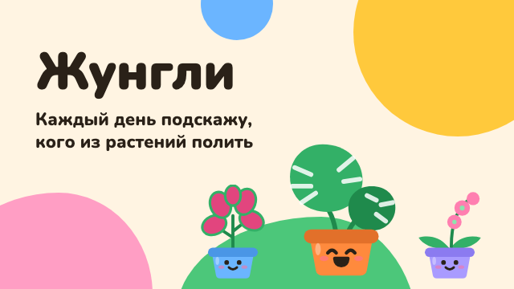

# Telegram

Жунгли run in Telegram as a mini app of the bot [@ZhungliPlantsBot](https://t.me/ZhungliPlantsBot). It's the same app as the website, with plants stored in Telegram's cloud.

- **Mini app:** `https://zhungli.zmoki.xyz/tg`
- **Link to share:** `https://t.me/ZhungliPlantsBot?startapp`, which opens the app straight away.
- **Author contact in the app:** [@zmoki](https://t.me/zmoki), for ideas and bugs.

## Bot

The bot has no backend: it doesn't answer messages and sends nothing. Everything happens in the mini app. Daily reminders and a feedback inbox would need a server; see the [`idea` issues](https://github.com/Zmoki/zhungli/issues?q=label%3Aidea).

BotFather settings:
- **Mini App:** enabled, URL `https://zhungli.zmoki.xyz/tg`. This adds an Open button to the bot's profile.
- **Menu button:** «Жунгли», same URL. It sits next to the message field.
- **Profile photo:** the app icon (`icons/icon-512.png`).

### What people see in Telegram

Snapshot of 2026-11-09. Only Name and About can be checked from outside (on the bot's t.me page); the rest is what was given to BotFather.

**Name:** Жунгли

**About** (profile, and the description on the t.me page):

```
Подсказываю, какие растения проверить и полить сегодня. Растения и фото — в облаке Телеграма.
```

**Description** («Что умеет этот бот?» in an empty chat, under the welcome picture):

```
Жунгли — помощник для комнатных растений.

🌱 Каждый день подскажу, кого проверить и полить, — без долгов и красных просрочек.
💧 Запомню, как быстро сохнет каждое растение.
☀️ Подскажу, кому темно, а кому слишком ярко.
☁️ Растения, фото и заметки хранятся в облаке Телеграма и есть на всех ваших устройствах.

Нажмите кнопку ниже, чтобы начать.
```

**Welcome picture** (640×360):



When the app's features change, update these texts in BotFather and here.

## Mini app vs. Telegram's browser

A zhungli.zmoki.xyz link tapped in a chat opens in Telegram's in-app browser, not the mini app. Its storage can be wiped, so «Сегодня» shows a hint with a button to the mini app. The hint changes if plants are already there: move them with «Сохранить копию» / «Восстановить».

The app counts as the mini app when it was opened at `/tg`. The flag stays in `sessionStorage`, so it holds after navigation inside the app.

The website and the mini app keep separate collections. A backup file moves plants between them.

## What the mini app adds

All of it is in `telegram.js`, which loads only in the mini app:
- **Theme:** Telegram's light or dark theme instead of the system one, and matching header and bottom bars.
- **Back button:** Telegram's button closes the open sheet.
- **Haptics:** a light tap when a task is done.
- **Links:** outside links open in Telegram (t.me) or the browser, not inside the mini app.
- **Home screen:** Telegram's own «add to home screen» (Bot API 8.0+), offered on «Сегодня» until the icon is added.
- **Cloud sync** of plants and photos.

## Cloud sync

Telegram CloudStorage belongs to the Telegram account, so plants follow the person to every device. It only holds short text values (4096 bytes each, 1024 keys per user).

**Plants:** the whole state as JSON in pieces of 1300 characters: `s0`, `s1`, … and `sn`, their count.
- **Pull** at start and on every return to the app, since Telegram Desktop keeps the mini app open.
- **Push** a few seconds after the last change, or when the app is hidden.
- **The newest copy wins** (`savedAt`). There's no merging: if two devices change plants at the same time, the later save wins.
- **Safety:**
  - a device that never had plants never uploads, so a fresh empty device can't wipe the cloud;
  - an empty copy left by an older version never beats real plants;
  - a damaged copy is replaced with this device's plants.
- **«Начать с чистого листа»** clears the cloud copy too, or the plants would come back.

**Photos:** a copy up to 400 px of each photo; the original stays on the device it was taken on.
- **Index:** `m0`, `m1`, … and `mn`, with `{ plantId: { h, t, n } }`: hash, time and number of pieces.
- **Pieces:** `f_<plantId>_<i>`, 4000 characters each, at most 800 pieces in all (the rest of the keys are for the plants).
- Photos sync after the plants are reconciled. Newer photos replace older ones, and photos of removed plants are deleted.

Before changing sync, test it with a fake `Telegram.WebApp` and CloudStorage. Sync events (`cloud_checked`, `cloud_restored`, `cloud_error`, `photos_synced`) are in [ANALYTICS.md](ANALYTICS.md).

## Hosting

`_redirects` serves the app at `/tg`. `_headers` gives `/tg` its own CSP: it allows `telegram.org` scripts and the `web.telegram.org` frame. The rest of the site keeps the strict headers.
